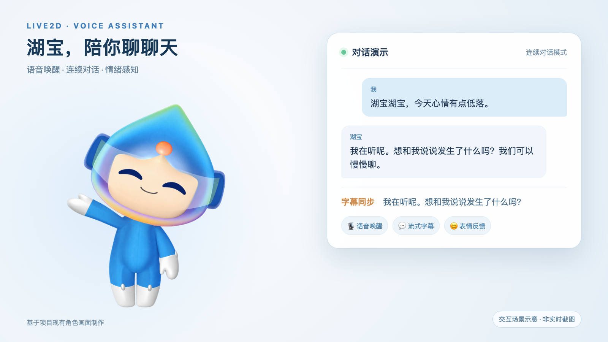

# 湖宝 · Live2D 语音聊天助手

完整项目源码与开发分支：[Deng-summer/live2d-voice-assistant](https://github.com/Deng-summer/live2d-voice-assistant)。本仓库保留轻量展示页。

一个以 Live2D 角色为交互入口的语音助手项目。原型结合了唤醒词检测、语音识别、连续对话、流式字幕、语音合成，以及摄像头表情识别探索。

> 图片是基于现有角色画面制作的**交互场景示意**，对话文案是展示用样例，不代表当前线上 API 可以实时完成这段对话。

## 我做了什么

- 将 Live2D 角色、动作和页面状态关联，让助手在聆听、思考、说话等阶段给出可见反馈。
- 接入语音唤醒、语音识别和语音合成，设计单轮与连续对话流程。
- 将识别文本与回复展示在字幕区域，探索人脸表情识别对回复语气的影响。

## 当前状态

项目原型能够展示角色动画。旧版服务依赖本地 Token 服务、第三方语音 API 和独立对话后端；截至 2026 年 10 月，这些链路尚未完成重新接入，因此本仓库提供作品展示页，不宣称实时语音聊天已恢复。原项目的人脸表情检测入口目前处于注释状态。

本仓库是**公开安全的作品展示版**，包括展示页和素材；旧项目完整源码包含硬编码历史密钥、部署地址及第三方模型素材，未经清理不适合直接公开。

## 本地查看

直接在浏览器打开 `index.html`。展示页无需后端或 API 密钥。

## 恢复实时功能的建议

1. 轮换历史语音服务密钥，将新密钥仅放在后端环境变量或密钥管理服务；浏览器端不保存长期密钥。
2. 启动并保护 Token 服务，确认页面可以请求到新的短期 Token；本地页面目前请求 `localhost:3001/token`。
3. 重新部署对话后端，确认 `/ai/process_dialogue` 与连续对话接口能返回流式结果，再检查字幕解析。
4. 逐项测试唤醒、录音权限、识别、回复、合成和字幕；最后再决定是否重新启用表情识别。

## 展示素材

- [对话场景示意图](./湖宝-对话场景示意.png)
- [展示页源码](./index.html)
